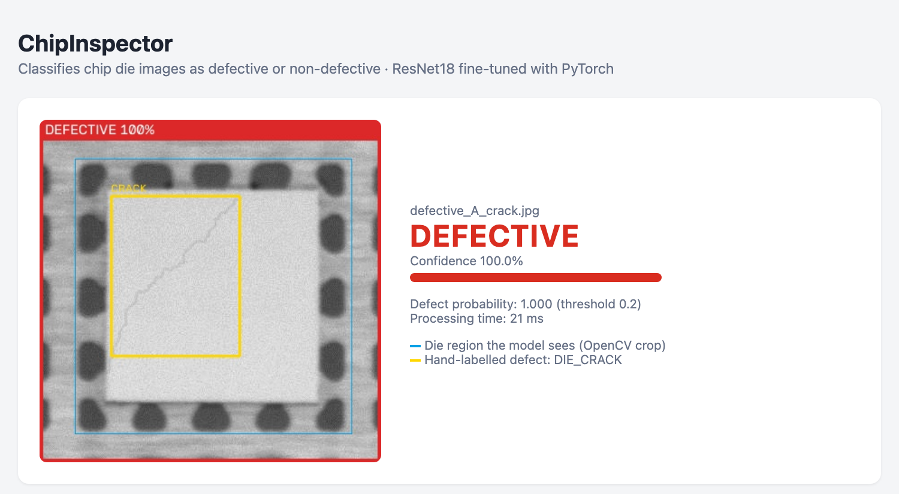
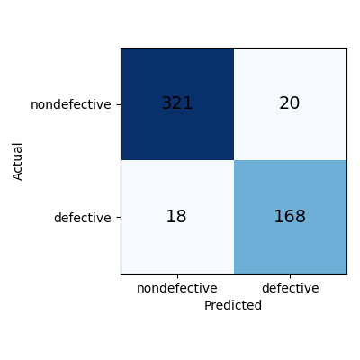

# ChipInspector

[](https://github.com/hzkhan3/ChipInspector/actions/workflows/ci.yml)

[](LICENSE)

Binary classifier for semiconductor chip die images (defective vs. non-defective).
OpenCV first crops each image to the die (threshold + morphology + contours), then a fine-tuned ResNet18 classifies the crop.
A small Flask app runs the whole pipeline offline.



## Results (held-out test set, 527 images)

| Accuracy | Recall | Precision | F1 |
|---|---|---|---|
| 92.8% | 90.3% | 89.4% | 0.898 |

The decision threshold (0.2) was tuned on the validation set to favour recall, since a missed defect costs more than a false alarm.
Validation recall was 95.7%, and test recall came in lower at 90.3%. That's expected: a threshold tuned on one set looks slightly better there than on unseen data.
With 527 test images, the 95% confidence interval on accuracy is about ±2.2%.

## Error analysis

| Test set | Images | Accuracy | Recall | Precision | ROC-AUC |
|---|---|---|---|---|---|
| Dataset A | 322 | 97.8% | 98.3% | 95.8% | 0.998 |
| Dataset B | 205 | 84.9% | 76.8% | 77.9% | 0.866 |

<p>
  
  
</p>

- **Dataset B is the weak spot.** 16 of the 18 missed defects come from Dataset B. Their label boxes show why: in 14 of them the smallest defect is 5–9 px wide, usually a thin broken sliver at the die edge or a small ink mark on a ~258 px image.
- **Things that did not fix it:** training at 320 px instead of 224 and the die crop both left Dataset B's AUC about where it was (0.865 → 0.866). This is a localization problem, so the next step is an object detector trained on the defect boxes.
- **Shortcut check:** in Dataset A, defective and good chips were mostly photographed at different zoom levels, so a model could learn the zoom instead of the defect. A model trained without the crop still scored 96–97% on images framed like the other class, so it wasn't relying on zoom much. The die crop removes the signal entirely: every image becomes "die fills the frame". (`good_A_closeup.jpg` in the demo is a good chip at the "defective" zoom, and it passes.)

Reproduce these numbers with `python -m scripts.evaluate && python -m scripts.error_analysis`. Intended use and limitations are in the [model card](MODEL_CARD.md).

## Quick start: run the demo

```bash
git clone https://github.com/hzkhan3/ChipInspector.git && cd ChipInspector
python -m venv .venv && source .venv/bin/activate
pip install -r requirements.txt
python -m scripts.download_model   # trained weights (43 MB, checksum-verified)
python app.py                      # open http://127.0.0.1:8000
```

Click a sample in `demo_samples/` or upload any chip image. Blue shows the die crop the model sees. Yellow shows hand-labelled defect boxes (only for the bundled defective samples).

### JSON API

The same server exposes the model as an API:

```bash
curl -F "file=@demo_samples/defective_A_crack.jpg" http://127.0.0.1:8000/api/predict
```
```json
{"label": "defective", "confidence": 0.99999, "defect_probability": 0.99999, "die_box": [39, 43, 345, 347]}
```

`die_box` is the OpenCV die crop as `[x0, y0, x1, y1]` in pixels. Bad input returns `{"error": ...}` with status 400 (not an image) or 413 (over 10 MB). `GET /healthz` returns `{"status": "ok"}`.

### Docker

```bash
docker build -t chipinspector .            # CPU-only torch; downloads and verifies the v1.0 weights
docker run -p 8000:8000 chipinspector      # gunicorn on http://127.0.0.1:8000 (web page + API)
```

CI builds the image and smoke-tests the running container on every push.

## How it works

```
image ─► OpenCV die crop ─► resize 224 / normalize ─► ResNet18 ─► P(defective) ─► threshold 0.2 ─► verdict + annotated image
```

1. **Die crop** (`src/data/preprocessing.py`): a threshold set between Otsu and the 99th-percentile brightness, morphological opening to cut off solder bumps, then the largest contour. It makes the die fill the frame and removes a zoom-level shortcut between the classes.
2. **Classifier** (`src/models/classifier.py`): ImageNet-pretrained ResNet18 with a 2-class head, fine-tuned for 10 epochs. The checkpoint with the lowest validation loss is kept.
3. **Inspection** (`src/inspection/pipeline.py`): predicts, then draws the verdict, die box and any labelled defect boxes with OpenCV. The CLI and the web app share this code.

## Reproduce from scratch

### Get the data

Download the [Chip-surface-defect-dataset](https://github.com/HiHiAllen/Chip-surface-defect-dataset) (the authors host it on [Google Drive](https://drive.google.com/file/d/1_L7ovWgIBD15Tr5GqzKLJlNCYMVCJvBB/view?usp=drive_link)) and extract the real images so they look like this:

```
data/raw/real/
├── DatasetA-Real/
│   ├── defective/{image,label}/   # .jpg + Pascal VOC .xml
│   └── nondefective/
└── DatasetB-Real/
    ├── defective/{image,label}/
    └── nondefective/
```

The path is set by `data.raw_dir` in `config/config.yaml`. Only the real images are used. The synthetic set is not.

### Train and evaluate

```bash
python -m scripts.explore_dataset            # counts per dataset and class (expect 3,511 images)
python -m scripts.split_dataset              # 70/15/15 stratified split -> data/splits/
python -m scripts.train                      # fine-tune ResNet18 -> models/best_model.pt (needs internet once for ImageNet weights)
python -m scripts.evaluate                   # test metrics -> outputs/reports/
python -m scripts.error_analysis             # per-dataset metrics, missed defects, PR curve
python -m scripts.inspect_image img.jpg      # classify one image -> outputs/annotated/ + JSON report
```

All settings (split sizes, seed, image size, learning rate, threshold) live in `config/config.yaml`.

## Development

```bash
pip install -r requirements-dev.txt
python -m pytest     # tests use an untrained model, so no data or weights needed
ruff check .
```

CI runs lint and tests on Python 3.10 and 3.12 for every push and pull request.

## Project layout

```
app.py                 Flask demo + JSON API (offline)
config/config.yaml     all settings
scripts/               entry points: explore, split, train, evaluate, error_analysis, inspect_image, download_model
src/data/              dataset, label parsing, OpenCV die crop + transforms
src/models/            ResNet18 classifier, training loop, Predictor
src/inspection/        end-to-end analyze/inspect + JSON reports
src/evaluation/        metrics
src/utils/             OpenCV drawing, confusion-matrix plot
tests/                 pytest suite
notebooks/             initial dataset audit
```

## Dataset

Images come from the **Chip-surface-defect-dataset** by [HiHiAllen](https://github.com/HiHiAllen/Chip-surface-defect-dataset): 2,270 real non-defective images, 1,241 real defective images and 7,250 synthetic defective images.
The dataset repository has no license, so its images stay the property of their authors.
This repo redistributes only the 8 sample images in `demo_samples/` so the demo works out of the box. They will be removed on request.

## License

Code: [MIT](LICENSE). Dataset images: see above.
