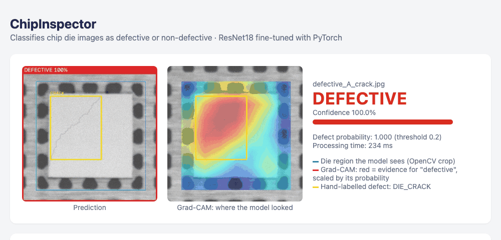
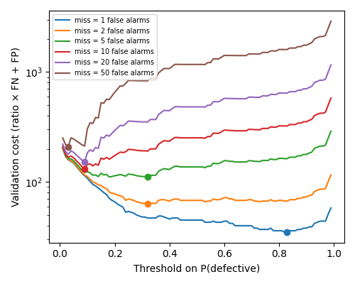
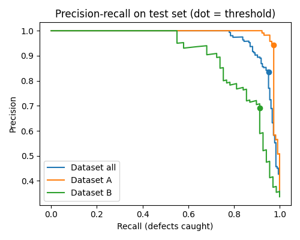
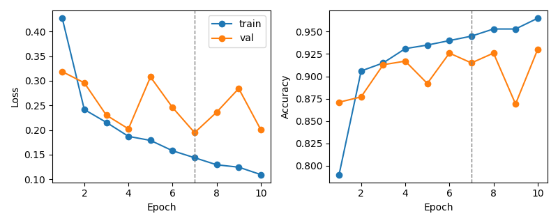

# ChipInspector

[](https://github.com/hzkhan3/ChipInspector/actions/workflows/ci.yml)

[](LICENSE)

Binary classifier for semiconductor chip die images (defective vs. non-defective).
OpenCV first crops each image to the die (threshold + morphology + contours), then a fine-tuned ResNet18 classifies the crop.
A small Flask app runs the whole pipeline offline.



## Results (held-out test set, 527 images)

| Accuracy | Recall | Precision | F1 |
|---|---|---|---|
| 91.7% | 95.2% | 83.5% | 0.889 |

These are for model v1.1, trained on a reproducible split (sorted file lists, seed 42). v1.0 used an OS-dependent file order, so its test set (92.8% accuracy, 90.3% recall at threshold 0.2) isn't directly comparable. Ranking quality is the same: test ROC-AUC is 0.973 for both.

### Choosing the threshold

The model outputs P(defective). The threshold that turns this into a verdict depends on what a mistake costs, so `scripts/tune_threshold.py` picks it on the **validation set** by minimising `ratio × missed defects + false alarms` for several cost ratios. The test set is only used to report the result.

| A missed defect costs | Threshold | Test misses | Test false alarms | Test recall | Test precision |
|---|---|---|---|---|---|
| 1 false alarm | 0.83 | 26 | 7 | 86.0% | 95.8% |
| 2–5 false alarms | **0.32** (used) | 9 | 35 | 95.2% | 83.5% |
| 10–20 false alarms | 0.09 | 5 | 116 | 97.3% | 60.9% |
| 50 false alarms | 0.03 | 3 | 165 | 98.4% | 52.6% |



0.32 is cost-optimal when a miss costs 2–5 false alarms. Catching more defects quickly gets expensive: going from 9 to 5 misses costs 81 more false alarms. That's another sign the remaining misses need a better model rather than a lower threshold.
Validation recall at 0.32 was 91.4% and test recall 95.2%. With ~186 defects per split, a handful of images moves recall by several points.
With 527 test images, the 95% confidence interval on accuracy is about ±2.4%.

## Error analysis

| Test set | Images | Accuracy | Recall | Precision | ROC-AUC |
|---|---|---|---|---|---|
| Dataset A | 322 | 96.9% | 97.4% | 94.2% | 0.987 |
| Dataset B | 205 | 83.4% | 91.3% | 69.2% | 0.918 |

<p>
  
  
</p>

- **Dataset B is the weak spot.** It accounts for 6 of the 9 missed defects and 28 of the 35 false alarms. Its label boxes show why it's hard: 4 of those 6 misses are 5–8 px wide (thin broken slivers at the die edge or a small ink mark on a ~258 px image), and the other 2 are small ink marks of 10–11 px.
- **Size isn't the whole story.** Dataset A's 3 misses are confident (P ≤ 0.01), and one is a 41 px crack.
- **Things that did not fix it** (earlier experiments on the v1.0 split): training at 320 px instead of 224 and the die crop both left Dataset B's AUC about where it was (0.865 → 0.866). This is a localization problem, so the next step is an object detector trained on the defect boxes.
- **Shortcut check** (v1.0 split): in Dataset A, defective and good chips were mostly photographed at different zoom levels, so a model could learn the zoom instead of the defect. A model trained without the crop still scored 96–97% on images framed like the other class, so it wasn't relying on zoom much. The die crop removes the signal entirely: every image becomes "die fills the frame". (`good_A_closeup.jpg` in the demo is a good chip at the "defective" zoom, and it passes.)

## Explainability (Grad-CAM)

Next to every prediction, the app and CLI show a [Grad-CAM](https://arxiv.org/abs/1610.02391) heatmap of where the model looked. It comes from ResNet18's last convolutional block, is mapped back onto the die crop, and is scaled by P(defective), so a confident pass shows no hotspot.

To check that the heatmaps are meaningful, `scripts/gradcam_check.py` plays the "pointing game": on each defective test image, does the heatmap's hottest point land on a hand-labelled defect box?

| Defective test images | Peak inside a labelled box | Peak within half a heatmap cell |
|---|---|---|
| Dataset A (117) | 58.1% | 87.2% |
| Dataset B (69) | 4.3% | 79.7% |
| Defects the model caught (177) | 39.5% | 88.1% |
| Defects the model missed (9) | 11.1% | 11.1% |

Grad-CAM on ResNet18 is a 7×7 grid, so one cell covers ~25 px of the die. That's why the tolerance column matters, and why Dataset B's 5–9 px slivers are rarely hit exactly.
The last row is the most telling: when the model misses a defect, it usually wasn't looking at it (1 of 9). That supports the error analysis above: the classifier doesn't localize small defects, and a detector would.

Reproduce these numbers with `python -m scripts.evaluate && python -m scripts.error_analysis && python -m scripts.gradcam_check && python -m scripts.tune_threshold`. Intended use and limitations are in the [model card](MODEL_CARD.md).

## Quick start: run the demo

```bash
git clone https://github.com/hzkhan3/ChipInspector.git && cd ChipInspector
python -m venv .venv && source .venv/bin/activate
pip install -r requirements.txt
python -m scripts.download_model   # trained weights (43 MB, checksum-verified)
python app.py                      # open http://127.0.0.1:8000
```

Click a sample in `demo_samples/` or upload any chip image. Blue shows the die crop the model sees. Yellow shows hand-labelled defect boxes (only for the bundled defective samples).

### JSON API

The same server exposes the model as an API:

```bash
curl -F "file=@demo_samples/defective_A_crack.jpg" http://127.0.0.1:8000/api/predict
```
```json
{"label": "defective", "confidence": 0.99999, "defect_probability": 0.99999, "die_box": [39, 43, 345, 347]}
```

`die_box` is the OpenCV die crop as `[x0, y0, x1, y1]` in pixels. Bad input returns `{"error": ...}` with status 400 (not an image) or 413 (over 10 MB). `GET /healthz` returns `{"status": "ok"}`.

### Docker

```bash
docker build -t chipinspector .            # CPU-only torch; downloads and verifies the v1.1 weights
docker run -p 8000:8000 chipinspector      # gunicorn on http://127.0.0.1:8000 (web page + API)
```

CI builds the image and smoke-tests the running container on every push.

## How it works

```
image ─► OpenCV die crop ─► resize 224 / normalize ─► ResNet18 ─► P(defective) ─► threshold 0.32 ─► verdict + annotated image
```

1. **Die crop** (`src/data/preprocessing.py`): a threshold set between Otsu and the 99th-percentile brightness, morphological opening to cut off solder bumps, then the largest contour. It makes the die fill the frame and removes a zoom-level shortcut between the classes.
2. **Classifier** (`src/models/classifier.py`): ImageNet-pretrained ResNet18 with a 2-class head, fine-tuned for 10 epochs. The checkpoint with the lowest validation loss is kept.
3. **Inspection** (`src/inspection/pipeline.py`): predicts, then draws the verdict, die box and any labelled defect boxes with OpenCV. The CLI and the web app share this code.



Validation loss is noisy (spikes at epochs 5 and 9) while training loss keeps falling, so keeping the lowest-validation-loss checkpoint (epoch 7 for v1.1) matters.

### Experiment: cosine learning-rate schedule (not adopted)

The noisy validation loss suggested decaying the learning rate (`train.lr_schedule: cosine`). To tell a real gain from luck, I trained each schedule with two training seeds (same split) and compared them on **validation only**:

| Schedule | Seed | Best val loss | Val accuracy | Val ROC-AUC | Dataset B val AUC | Val-loss std, epochs 6–10 |
|---|---|---|---|---|---|---|
| constant (v1.1) | 42 | 0.195 | 91.5% | 0.973 | 0.880 | 0.037 |
| cosine | 42 | 0.179 | 92.6% | 0.975 | 0.911 | 0.028 |
| constant | 7 | 0.160 | 94.3% | 0.983 | 0.919 | 0.038 |
| cosine | 7 | 0.155 | 94.1% | 0.981 | 0.902 | 0.020 |

Cosine made training smoother and lowered validation loss a little, but mean validation AUC was identical (0.978), and changing the seed moved the results more than changing the schedule. So v1.1 stays, and the test set was never used for this comparison. The option remains in the config.

### Experiment: focal loss (not adopted)

[Focal loss](https://arxiv.org/abs/1708.02002) (`train.loss: focal`, γ = 2) down-weights easy examples so training focuses on hard ones, such as Dataset B's small defects. Same setup: two seeds, validation only, checkpoint chosen by cross-entropy so runs compare. "Cost" is `3 × misses + false alarms` at each run's best validation threshold (the 2–5 policy used for v1.1).

| Loss | Seed | Val ROC-AUC | Dataset B val AUC | Val misses / false alarms | Cost |
|---|---|---|---|---|---|
| cross-entropy (v1.1) | 42 | 0.973 | 0.880 | 16 / 31 | 79 |
| cross-entropy | 7 | 0.983 | 0.919 | 17 / 16 | 67 |
| focal | 42 | 0.972 | 0.914 | 11 / 43 | 76 |
| focal | 7 | 0.977 | 0.906 | 18 / 23 | 77 |

Focal loss helped Dataset B for one seed and hurt it for the other. Averaged over both seeds, overall AUC (0.975 vs 0.978) and cost (76.5 vs 73) were slightly worse. Reweighting the loss doesn't fix defects the network can't resolve at 224 px, which again points to a detector.

## Reproduce from scratch

### Get the data

Download the [Chip-surface-defect-dataset](https://github.com/HiHiAllen/Chip-surface-defect-dataset) (the authors host it on [Google Drive](https://drive.google.com/file/d/1_L7ovWgIBD15Tr5GqzKLJlNCYMVCJvBB/view?usp=drive_link)) and extract the real images so they look like this:

```
data/raw/real/
├── DatasetA-Real/
│   ├── defective/{image,label}/   # .jpg + Pascal VOC .xml
│   └── nondefective/
└── DatasetB-Real/
    ├── defective/{image,label}/
    └── nondefective/
```

The path is set by `data.raw_dir` in `config/config.yaml`. Only the real images are used. The synthetic set is not.

### Train and evaluate

```bash
python -m scripts.explore_dataset            # counts per dataset and class (expect 3,511 images)
python -m scripts.split_dataset              # 70/15/15 stratified split -> data/splits/
python -m scripts.train                      # fine-tune ResNet18 -> models/best_model.pt (needs internet once for ImageNet weights)
python -m scripts.evaluate                   # test metrics -> assets/test_metrics.json, predictions -> outputs/
python -m scripts.error_analysis             # per-dataset metrics, missed defects, PR curve
python -m scripts.gradcam_check              # does the Grad-CAM peak land on the labelled defect?
python -m scripts.tune_threshold             # threshold per cost ratio, chosen on validation
python -m scripts.inspect_image img.jpg      # classify one image -> outputs/annotated/ (+ _gradcam.jpg) + JSON report
```

All settings (split sizes, seed, image size, learning rate, threshold) live in `config/config.yaml`.
Each training run also writes a log to `outputs/runs/<timestamp>/`: the config, the git commit, per-epoch losses and accuracies, the checkpoint's sha256 and the curves above.

## Development

```bash
pip install -r requirements-dev.txt
python -m pytest     # tests use an untrained model, so no data or weights needed
ruff check .
```

CI runs lint and tests on Python 3.10 and 3.12 for every push and pull request.

## Project layout

```
app.py                 Flask demo + JSON API (offline)
config/config.yaml     all settings
scripts/               entry points: explore, split, train, evaluate, error_analysis, gradcam_check, tune_threshold, inspect_image, download_model
src/data/              dataset, label parsing, OpenCV die crop + transforms
src/models/            ResNet18 classifier, training loop, Predictor, Grad-CAM
src/inspection/        end-to-end analyze/inspect + JSON reports
src/evaluation/        metrics
src/utils/             OpenCV drawing, confusion-matrix plot
tests/                 pytest suite
notebooks/             initial dataset audit
```

## Dataset

Images come from the **Chip-surface-defect-dataset** by [HiHiAllen](https://github.com/HiHiAllen/Chip-surface-defect-dataset): 2,270 real non-defective images, 1,241 real defective images and 7,250 synthetic defective images.
The dataset repository has no license, so its images stay the property of their authors.
This repo redistributes only the 8 sample images in `demo_samples/` so the demo works out of the box. They will be removed on request.

## License

Code: [MIT](LICENSE). Dataset images: see above.
